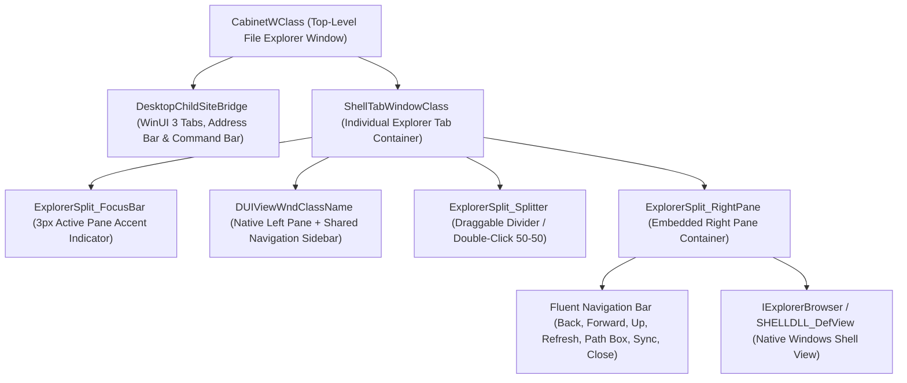

# Explorer Split View

A lightweight, native C++20 **Dual-Pane / Split-View** plugin for the built-in **Windows 11 File Explorer** (`explorer.exe`, tested on 24H2 / 25H2 Build 26200).

Browse and manage **two folders side by side inside a single standard File Explorer window** (`Win+E`) — with native Windows 11 Dark/Light theme styling, full tab compatibility, drag-and-drop between panes, active-pane sidebar routing, and near-zero resource usage (`~2.6 MB` private RAM, `0.0%` idle CPU).

---

## Features

- **Seamless Native Integration**: Embeds a real Windows Shell folder view (`IExplorerBrowser` / `SHELLDLL_DefView`) directly inside standard `CabinetWClass` / `ShellTabWindowClass` File Explorer tabs — preserving native context menus, icons, thumbnails, columns, inline rename (`F2`), and drag-and-drop across panes.
- **Tab-Aware Architecture**: Each Windows 11 File Explorer tab maintains its own independent Split View state and proportions.
- **Smart Navigation Sidebar Routing**: Clicking any folder, drive, or pinned item in File Explorer's left navigation tree opens it in whichever pane (**Left** or **Right**) is currently active.
- **Instant Toggle & Folder Sync**:
  - Press **`Ctrl + Shift + E`** inside any File Explorer window (works across XAML islands such as *Home* / *Gallery* and any keyboard layout).
  - Click the in-window **`[Split]`** button in the top-right corner of the file list (or **`[×]`** on the right pane header to close).
  - Automatically opens the left pane's current directory in the right pane when activated.
- **Draggable Splitter & Active-Pane Indicator**:
  - Smoothly resize panes between `20%` and `80%`; **double-click** the center divider to snap back to **`50/50`**.
  - A crisp `3px` accent bar above the panes highlights which side currently holds focus.
- **Complete Keyboard Accelerator Isolation**: `Delete`, `F2`, `Ctrl+C/X/V/A/Z`, `Enter`, `Backspace`, `Ctrl+L`, `Alt+Left/Right/Up`, and `F5` operate strictly on the focused pane without leaking to the opposite pane.
- **Zero Admin Rights & Clean Unload**: Runs at standard user integrity level, modifies zero system files, and cleanly restores single-pane File Explorer windows on exit.

---

## Architecture



---

## Resource Footprint

| Metric | Measured Value |
| :--- | :--- |
| **Controller Binary (`ExplorerSplitController.exe`)** | `~139 KB` (pure Win32 C++20, static CRT) |
| **Hook Module (`ExplorerSplitHook.dll`)** | `~179 KB` (scoped to `explorer.exe` window threads only) |
| **Private Memory Usage** | `~2.6 MB` |
| **Idle CPU Usage** | `0.0%` (event-driven message loop) |

---

## Quick Start

### Option 1: Prebuilt Release
1. Download the latest `ExplorerSplitView-win-x64.zip` from **[Releases](../../releases)** and extract it to a permanent folder.
2. Run `ExplorerSplitController.exe` (or `Start-SplitView.bat`).
3. Open any File Explorer window (`Win+E`) and press **`Ctrl + Shift + E`** or click **`[Split]`**.

### Option 2: Build from Source
Requires **Windows 10/11 x64** and **Visual Studio 2022** (or **Visual Studio 2022 Build Tools**) with the *Desktop development with C++* workload and Windows 10/11 SDK.

```bat
git clone https://github.com/andreiparshin/explorer-split-view.git
cd explorer-split-view
build.bat
Start-SplitView.bat
```

---

## Controls & Shortcuts

| Action | Shortcut / Control |
| :--- | :--- |
| **Toggle Split View** | `Ctrl + Shift + E` or click `[Split]` / `[×]` |
| **Resize Panes** | Drag the center vertical splitter (`20%` – `80%`) |
| **Reset to 50/50** | Double-click the center splitter |
| **Focus Right Pane Address Bar** | `Ctrl + L` (while right pane is active) |
| **Navigate Back / Forward / Up (Right Pane)** | `Alt + Left` / `Alt + Right` / `Alt + Up` or `Backspace` |
| **Refresh Right Pane** | `F5` |
| **Sync Right Pane to Left Folder** | Click `⇄` on the right pane toolbar |
| **Launch at Windows Startup** | Right-click the System Tray icon → **Launch at Windows Startup** |
| **Unload Plugin & Exit** | Right-click the System Tray icon → **Exit (Unload from Explorer)** |

### CLI Arguments

```bat
ExplorerSplitController.exe            :: Launch tray controller and split current Explorer window
ExplorerSplitController.exe --autorun  :: Launch silently in the system tray (used for Windows startup)
ExplorerSplitController.exe --toggle   :: Toggle Split View in the active Explorer window
ExplorerSplitController.exe --reset    :: Reset active Split View ratio to 50/50
ExplorerSplitController.exe --stop     :: Restore all Explorer windows and exit controller
```

---

## Automated Verification

With the project built via `build.bat`, run the Win32 integration test suite:

```bat
python tests\verify_split_view.py
```

---

## License

Released under the [MIT License](LICENSE). Copyright (c) 2026 [Andrei Parshin](https://github.com/andreiparshin).
